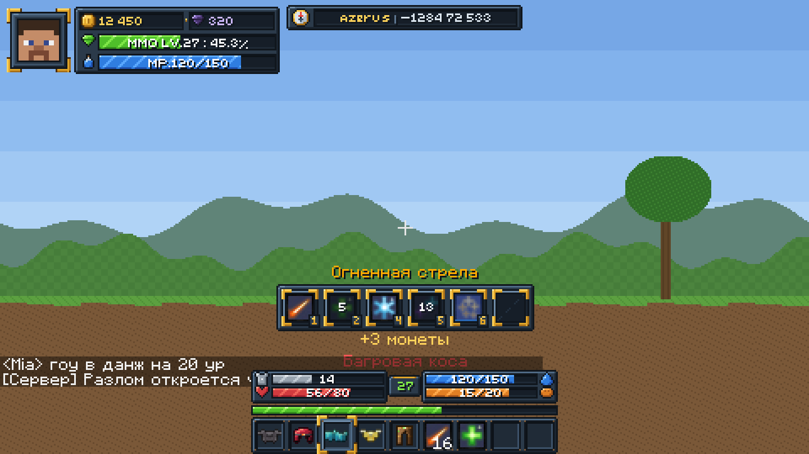

# Azerus HUD для MythicHUD (slate + gold)

Новый HUD и панель навыков в стиле «тёмный сланец + золото». Старый HUD (Volya `mmohud`, `skill_casting_bar`)
**не удаляется и не меняется** — переключение идёт только списком `layout.default` в `config.yml`, откат — тем же.

Папка повторяет пути `/plugins/MythicHUD/…`: заливаются только новые/изменённые файлы.
Бэкап того, что заменяется, — `ops/mythichud-prod-before-azerus/` (снят с прода 18.11, совпадает со снимком `server/`).



Превью (1920×1080, GUI scale 4 = 480×270 GUI-px, ×3): `preview/new_hud.png`, `preview/new_hud_casting.png`
(режим каста), `preview/new_hud_status.png` (класс с энергией, поглощение, яд, Голод, под водой, валюта-заглушка), `preview/old_hud.png`, `preview/old_hud_casting.png`, `preview/compare_old_vs_new.png`, крупно:
`preview/zoom_*.png`. Рисуются эмулятором раскладки MythicHUD прямо из YAML (`tools/preview.py`).

## Файлы

| путь (= на сервере в `/plugins/MythicHUD/`) | что |
|---|---|
| `config.yml` | копия продового, изменён только `layout.default`: `azerus-layout`, `partyhud-mmo-layout`, `azerus-skillbar-layout` |
| `hud_assets/hud/azerus-hud.yml` | ассеты HUD (15 шт., префикс `azerus_`) |
| `hud_assets/hud/azerus-skillbar.yml` | ассет панели навыков `azerus_skillbar` |
| `layouts/azerus-layout.yml`, `layouts/azerus-skillbar-layout.yml` | раскладки |
| `source-pack/assets/mythichud/textures/assets/azerus/*.png` | 58 текстур |
| `source-pack/assets/minecraft/textures/gui/sprites/hud/hotbar*.png` | скин ванильного хотбара (4 спрайта) |
| `tools/gen_textures.py` | рисует все текстуры (PIL, попиксельно); `python3 -I tools/gen_textures.py` |
| `tools/gen_yaml.py` | пишет все YAML (вся геометрия и плейсхолдеры — тут) |
| `tools/validate.py` | YAML парсится, ассеты/шрифты/слушатели/текстуры существуют, текстуры ≤256, без полупрозрачности |
| `tools/preview.py` | превью |
| `tools/build_hl_pack.py` | пересборка `Nexo/pack/external_packs/hl-resourcepack.zip` из `built-pack` MythicHUD |

Иконки навыков не трогаются: `assets/skill_casting_bar/skills/*.png` (54 шт., уже на проде), сопоставление
ID → иконка скопировано из `skill_casting_bar-hud.yml`.

## Что показывает каждый элемент

Сверху слева (`azerus_player*`, отступ 4 px от угла):
- портрет 38×38: золотые L-уголки, сланцевая рамка, **голова игрока** — слой `head: {size: 3}` MythicHUD
  1.3.6 (лицо 8×8 скина ×3 = 24×24, со слоем шляпы; скин плагин качает сам, при ошибке — лицо по умолчанию);
- монеты (золотая монета): по умолчанию `%corevault_balance_short%` («12 450»), при включённом переключателе
  `/menu` (deluxemenus meta `currency`) — `%vault_eco_balance_fixed%`, как в старом HUD;
- вторая валюта (тёмный кристалл): `%azerus_gems%` — **такой валюты на сервере нет**; пока плейсхолдер не
  возвращает число, в поле серый «-». Поменять — `GEMS` в `tools/gen_yaml.py` (например `%playerpoints_points%`);
- зелёный кристалл + полоса `MMO LV.%mmocore_level% : %math_1_{mmocore_experience}*100/{mmocore_next_level}%%`,
  заполнение — слушатель `mmoexp` (`%mmocore_experience%` / `%mmocore_next_level%`);
- зелье + полоса `MP.%fill-value%/%fill-max%` (слушатель `mana` = `%mmocore_mana%` / `%mmocore_stat_max_mana%`);
  у классов с ресурсом «Энергия» (`%mmocore_mana_name%` = `Энергия`, то же условие, что в старом HUD) — золотая
  полоса и подпись `EN.`.

Сверху по центру (`azerus_location`, 140 px): компас + `%player_world% | %player_x% %player_y% %player_z%`.

Снизу (над хотбаром 182 px):
- левая плашка: броня (серая, `%fill-value%`, слушатель `armor40` = `%mmocore_stat_armor%`/40) над здоровьем
  (красное, `%player_health_rounded%/%player_max_health_rounded%`; с поглощением — жёлтая сумма и золотая
  полоска 2 px сверху по слушателю `absorption`; горение/заморозка/яд/иссушение — свои сердце и цвет полосы,
  те же условия, что у Volya: `%player-j17_is_burning%`, `%player-j17_is_freezing%`, `effect{e=poison|wither}`);
- правая плашка: мана (синяя, `cur/max`; у энергетических классов — золотая энергия) над голодом (оранжевый,
  `%fill-value%/20`; под эффектом Голода — оливковый и другая иконка; переключатель иконки еды
  `deluxemenus meta foodicon` сохранён: окорок/хлеб);
- между плашками — зелёный уровень `%hl_level%` (RoyalQuestClasses, как раньше) на значке, под ними полоса
  опыта на всю ширину хотбара (слушатель `rqexp` = `%hl_exp%`/`%hl_exp_needed%`, как раньше);
- воздух под водой — маленькая полоса под прицелом (только когда воздуха меньше максимума);
- хотбар: сланцевые ячейки, у выбранной — золотые уголки (`hotbar.png`, `hotbar_selection.png`, оба offhand).

Панель навыков (`azerus_skillbar`, 6 ячеек 22×22 на плашке 153×28, над actionbar): только у игроков с классом
(`%mmocore_class_id%` ≠ `HUMAN`); иконка по `%mmocore_id_bound_N%`; кулдаун — тёмная вуаль + секунды
(`%math_0:_{utils_shortcut_noskillcd_check:N}+1%`, когда `%mmocore_cooldown_bound_N%` > 0); не хватает маны —
синий налёт (`%utils_shortcut_mana_check:N%` > `%mmocore_mana%`); в режиме каста (`%mmocore_is_casting%`) —
золотые уголки на ячейках и клавиши-подсказки 1–7 со сдвигом по `%player_held_item_slot%` (та же логика, что
`input1..6`); имя только что применённого навыка над панелью (та же цепочка плейсхолдеров).

## Заливка (только после «заливай»)

Панель: `https://mgr.hosting-minecraft.pro/api/client/servers/88635a9b` (`files/write?file=…` — запись,
`files/contents?file=…` — чтение; папки при необходимости `files/create-folder`).

1. Сверить, что прод не менялся с бэкапа: `/plugins/MythicHUD/config.yml` == `ops/mythichud-prod-before-azerus/plugins/MythicHUD/config.yml`,
   sha256 `/plugins/Nexo/pack/external_packs/hl-resourcepack.zip` = `eb17855e6664286f45d4eb3b92c85cb89df589090e48d791d323edca8a8eb7a4`.
   Иначе — снять новый бэкап. На сервере положить копию `hl-resourcepack.zip.before-azerus-<дата>` рядом.
2. `python3 -I tools/validate.py` → OK.
3. Залить в `/plugins/MythicHUD/`: `hud_assets/hud/azerus-hud.yml`, `hud_assets/hud/azerus-skillbar.yml`,
   `layouts/azerus-layout.yml`, `layouts/azerus-skillbar-layout.yml`,
   `source-pack/assets/mythichud/textures/assets/azerus/` (58 png),
   `source-pack/assets/minecraft/textures/gui/sprites/hud/` (4 png), и последним `config.yml`.
4. Консоль: `mythichud reload` (алиасы `hud`, `mh`). В логе — без ошибок ассетов. Плагин пересобирает
   `/plugins/MythicHUD/built-pack`.
5. Пересобрать пак игроков (MythicHUD `copy-pack` выключен, игроки получают HUD из Nexo):
   ```
   python3 -I tools/build_hl_pack.py fetch --out /tmp/built-pack          # только GET
   python3 -I tools/build_hl_pack.py build --built /tmp/built-pack \
       --base ../ops/mythichud-prod-before-azerus/plugins/Nexo/pack/external_packs/hl-resourcepack.zip --out /tmp/hl-resourcepack.zip
   python3 -I tools/build_hl_pack.py check /tmp/hl-resourcepack.zip      # OK: есть azerus-layout, хотбар Azerus, оверлеи
   ```
   Залить `/tmp/hl-resourcepack.zip` в `/plugins/Nexo/pack/external_packs/hl-resourcepack.zip`.
6. Консоль: `nexo reload pack` — **да, Nexo должен пересобрать и разослать пак** (в нём новые глифы шрифтов
   MythicHUD, текстуры и хотбар). Между шагами 4 и 6 у игроков новый HUD без глифов — делать подряд.
7. Зайти клиентом 1.21.11 (GUI scale 3 и 4): панель слева сверху с головой, координаты, плашки, хотбар,
   F (режим каста) — уголки и клавиши, кулдаун. Если у игрока остался старый HUD — перезайти.
   Если текст в полосах сидит на 1 px выше/ниже — поправить `y` текстовых слоёв в `tools/gen_yaml.py`,
   `gen_yaml.py` → залить yml → шаги 4–6.

## Откат

См. `ops/mythichud-prod-before-azerus/README.md`. Коротко: вернуть `config.yml`, удалить 4 yml `azerus*`,
`mythichud reload`, вернуть `hl-resourcepack.zip` из бэкапа, `nexo reload pack`.

## Чего MythicHUD не умеет / ограничения

- **Регион** в верхней плашке: WorldGuard выключен (`.jar1`), плейсхолдера региона нет — показан мир
  (`%player_world%`); когда появится — заменить `WORLD` в `gen_yaml.py`.
- **Вторая валюта**: на сервере одна валюта (core-vault/Vault) — поле с плейсхолдером-заглушкой (см. выше).
- Ванильные **боссбары** (событие «Разлом» core-skyrift) рисуются в той же зоне сверху по центру, что и
  плашка координат, — во время события они перекрываются. Сдвинуть: `location` offset `y` в раскладке.
- Чат (ширина 320 px) и название предмета в руке ложатся на нижние плашки так же, как на ванильные сердца/броню;
  панель навыков поставлена выше actionbar (y 198) и названия предмета (y 211).
- Текст в полосах не обрезается: очень длинные значения (баланс > 9 знаков) вылезут за поле.
- Обводку текста (`outlined`) не используем — поведение в 1.3.6 не документировано; вместо неё тень
  `shadow: "#10161dff"` (shadow_color 1.21.4+).
- Точный вертикальный сдвиг текста шейдером MythicHUD эмулятор знает с точностью ±1 px (см. шаг 7).
- Регенерация (старый розовый блик на полосе) не перенесена.
